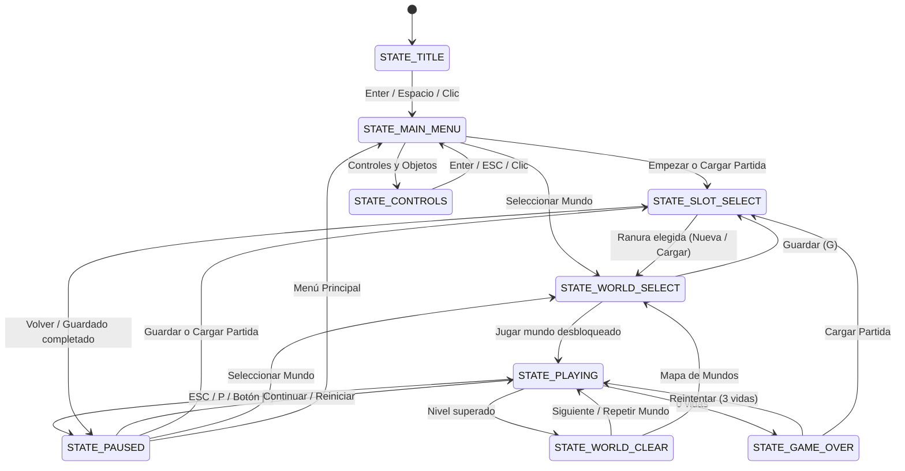

# Documentación de Cambios: Menús, HUD, Guardado, Power-Ups y Bombas

Este documento detalla todos los cambios arquitectónicos y de jugabilidad implementados en **Pocket Bomberman (`01-TBE`)**, explicando cómo se han construido el sistema de menús, la persistencia de partidas, el HUD, los *power-ups* y las nuevas mecánicas de bombas.

---

## 1. Resumen de Archivos Nuevos y Modificados

| Archivo | Estado | Responsabilidad principal |
| :--- | :---: | :--- |
| `01-TBE/graphics/PixelFont.h` / `.cpp` | **Nuevo** | Fuente bitmap `8x8` estilo Game Boy Color autogenerada en memoria con soporte UTF-8 español (`ÁÉÍÓÚÑ¡¿`) e iconos (`★ ♥ ► ◄`). |
| `01-TBE/ui/UIRenderer.h` / `.cpp` | **Nuevo** | Renderizador 2D inmediato sobre lienzo virtual fijo `320x240` (escalado `x3` en ventana `960x720`) para paneles, sprites, formas y texto. |
| `01-TBE/ui/MenuSystem.h` / `.cpp` | **Nuevo** | Máquina de estados completa del juego: Título, Menú Principal, Controles, Ranuras de Guardado/Carga, Mapa de Mundos, HUD, Pausa, Victoria y Game Over. |
| `01-TBE/core/SaveSystem.h` / `.cpp` | **Nuevo** | Gestión de 3 ranuras de guardado (`saves/slot1.sav` .. `slot3.sav`) y registro centralizado de mundos (`WorldDef`). |
| `01-TBE/entities/PowerUp.h` / `.cpp` | **Modificado** | 6 tipos de *power-up* con sprites reales `16x16` de `caracters.png`, animación flotante, tabla de probabilidades y periodo de gracia anti-quemado. |
| `01-TBE/entities/Bomb.h` / `.cpp` | **Modificado** | Física de gravedad en bombas, actualización dinámica de casilla al caer, pulso elástico de la mecha y parpadeo rojizo previo a detonar. |
| `01-TBE/entities/Player.h` / `.cpp` | **Modificado** | Efectos y topes de los 6 *power-ups*, temporizador del Chaleco (`VEST`), plataformas *one-way* sobre bombas (*Bomb-Jump*) y sincronización de *input* al salir de menús. |
| `01-TBE/world/Scene.h` / `.cpp` | **Modificado** | Puntuación, detección automática de puerta de salida y brillo al desbloquearse, rebote de enemigos contra bombas, eventos hacia el HUD/guardado y retardo dramático al ganar/morir. |
| `01-TBE/core/Game.h` / `.cpp` y `main.cpp` | **Modificado** | Ventana fija no redimensionable (`GLFW_RESIZABLE = GLFW_FALSE`), activación de `GL_BLEND`, entrada por flanco (`justPressed`, `mouseJustPressed`), conversión del ratón al espacio `320x240` y delegación del flujo a `MenuSystem`. |
| `01-TBE/01-TBE.vcxproj` / `.filters` | **Modificado** | Inclusión de los nuevos módulos (`core`, `graphics`, `ui`), soporte `Win32`/`x64` (`Debug` y `Release`) y compilación con `/utf-8`. |

---

## 2. Arquitectura Visual de la Interfaz (`UIRenderer` y `PixelFont`)

### 2.1. Lienzo virtual `320x240` independiente de la cámara
Mientras que `Scene` utiliza una cámara con *zoom* estilo portátil (`160x120` píxeles de mundo siguiendo al jugador), toda la interfaz de usuario se dibuja mediante `UIRenderer` con una proyección ortográfica propia de **`320 x 240` píxeles virtuales**:

- En una ventana de `960 x 720`, cada píxel virtual equivale exactamente a **`3 x 3` píxeles reales** (escalado entero perfecto con filtrado `GL_NEAREST`, sin distorsión ni subpíxeles borrosos).
- Se activó `glEnable(GL_BLEND)` con `glBlendFunc(GL_SRC_ALPHA, GL_ONE_MINUS_SRC_ALPHA)` en `Game::init()` para permitir fondos oscurecidos semitransparentes en la pausa, sombras paralelas y transiciones de fundido suaves.
- `UIRenderer` ofrece primitivas reutilizables:
  - **`panel(...)`**: construye las cajas clásicas estilo Game Boy Color combinando sombra proyectada, borde exterior oscuro, marco coloreado con bisel superior iluminado y cuerpo interior translúcido.
  - **`disc(...)`**: dibuja círculos *pixel-art* fila por fila mediante *spans* horizontales para los nodos y senderos del mapa de la isla.
  - **`sheet(...)`**: recorta cualquier región de `images/caracters.png` reutilizando el VAO/VBO compartido de `Bomb::drawSheetRect`, permitiendo además espejo horizontal cuando recibe un ancho negativo (`srcW < 0`).

### 2.2. Tipografía retro sin dependencias externas (`PixelFont`)
Para evitar dependencias pesadas como FreeType y conservar una estética 100 % fiel a 8 bits:

1. `PixelFont::buildFontAtlas()` construye al arrancar una textura `128x128` RGBA (`16x16` glifos de `8x8` píxeles) a partir de una tabla de patrones binarios de 5 bits por fila (`kGlyphTable`).
2. `PixelFont::decodeUtf8ToGlyphs()` decodifica cadenas UTF-8 directamente a índices del atlas, soportando mayúsculas/minúsculas, puntuación, caracteres españoles (**`Á, É, Í, Ó, Ú, Ñ, Ü, ¡, ¿`**) y símbolos de interfaz (**`★, ♥, ►, ◄`**).
3. En `MenuSystem.cpp` los caracteres especiales usan secuencias UTF-8 explícitas (`\xE2\x98\x85`, `\xC3\x81`, etc.) además del flag `/utf-8` en MSVC, garantizando que el texto se vea idéntico en cualquier configuración regional de Windows.

---

## 3. Máquina de Estados y Flujo de Menús (`MenuSystem`)

`MenuSystem` gobierna el ciclo de vida completo de la aplicación y delega la simulación del nivel en `Scene` únicamente cuando el juego está en `STATE_PLAYING`. Todos los menús pueden manejarse indistintamente con **teclado** (`Flechas`/`WASD`, `Enter`/`Espacio`, `ESC`/`P`) o **ratón** (*hover* + clic izquierdo, clic derecho para volver).

### Detalle de cada pantalla

1. **Pantalla de Título (`STATE_TITLE`) y Menú de Inicio (`STATE_MAIN_MENU`)**:
   - Renderiza `images/menu_title_bg.png` y el logotipo `images/menu_logo.png` con movimiento flotante suave.
   - Incluye una escena animada en la pradera inferior donde Bomberman y un enemigo Kirby corren en bucle siguiendo la curvatura de la colina.
   - El cursor de selección utiliza los 3 fotogramas de mecha de la bomba (`caracters.png`, fila 3).
   - Transiciones entre pantallas mediante fundido suave (`fade_`).

2. **Menú de Ranuras: Empezar, Cargar y Guardar Partida (`STATE_SLOT_SELECT` + `SaveSystem`)**:
   - Unifica tres modos de operación: **`SLOT_NEW`** (Empezar Partida), **`SLOT_LOAD`** (Cargar Partida) y **`SLOT_SAVE`** (Guardar Partida).
   - Cada tarjeta muestra retrato de Bomberman sobre el color temático del mundo, nombre del mundo, estrellas conseguidas (`★ completados/total`), fecha/hora (`DD/MM HH:MM`) y fila de estadísticas con iconos (`♥`, Bombas, Rango, Velocidad).
   - **Diálogos modales de seguridad (`renderConfirm`)**: pide confirmación `[ SÍ / NO ]` antes de sobrescribir una ranura ocupada o al borrar una partida con `SUPR`, `X` o el botón `[X]` de la tarjeta.
   - **Persistencia (`SaveSystem`)**: almacena archivos legibles en `saves/slot1.sav` .. `slot3.sav` con cabecera `POCKET_BOMBERMAN_SAVE_V1`, incluyendo una máscara de bits (`COMPLETED_MASK`) para registrar qué mundos han sido completados.
   - Si se abre desde la **Pausa**, guarda `slotReturnState_ = STATE_PAUSED` y `rendersSceneBehind()` mantiene el nivel congelado de fondo.

3. **Mapa de Selección de Mundo (`STATE_WORLD_SELECT`)**:
   - Utiliza `images/menu_world_bg.png` y lee la lista de mundos desde `SaveSystem::getWorlds()`.
   - **Caminos y desplazamiento animado**: cada `WorldDef` define su coordenada `mapNodePos` y una lista opcional de *waypoints* `pathFromPrev` (por ejemplo, el camino que gira y cruza el puente de madera entre el *Bosque Verde* y las *Ruinas Rocosas*). `renderWorldPaths()` dibuja piedras de paso con brillo animado en rutas desbloqueadas, y `beginTravel()` hace que Bomberman camine siguiendo todos los tramos del sendero al cambiar de nodo.
   - **Panel inferior informativo**: muestra título y temática del mundo, estado (`★ COMPLETADO`, `► DISPONIBLE` o `BLOQUEADO`), previsualización animada de la fauna del nivel (`PinkEnemy`, `KirbyEnemy`) y botón clicable **`JUGAR`**.
   - **Modo Libre y pruebas**: entrar desde `SELECCIONAR MUNDO` sin partida previa activa el *Modo Libre* con todos los mundos abiertos; además, pulsar **`U`** en el mapa desbloquea todos los mundos al instante para pruebas rápidas, y **`G`** permite guardar manualmente.

4. **Menú de Pausa (`STATE_PAUSED`)**:
   - Se activa con `ESC`, `P` o haciendo clic en el botón `[II]` de la esquina superior derecha del HUD.
   - Detiene por completo `Scene::update()` (congelando enemigos, mechas, explosiones y cronómetro) mientras dibuja el nivel debajo de un velo translúcido oscuro.
   - Al reanudar (`CONTINUAR`), invoca `Scene::syncPlayerInputLatch()` -> `Player::syncInputLatch()`, evitando que la pulsación de `ESPACIO` o `ENTER` usada para aceptar en el menú coloque una bomba por accidente en el primer fotograma.
   - `REINICIAR MUNDO` restaura `levelStartSnapshot_` (las estadísticas exactas con las que el jugador entró al nivel) para que reiniciar no duplique mejoras obtenidas a mitad de intento.

5. **Controles y Objetos (`STATE_CONTROLS`), Victoria (`STATE_WORLD_CLEAR`) y Derrota (`STATE_GAME_OVER`)**:
   - `STATE_CONTROLS` documenta dentro del propio juego todos los controles, el truco del *Bomb-Jump* y el efecto de cada *power-up* junto a su icono real.
   - Al superar un nivel, `onWorldCleared()` exporta las estadísticas supervivientes del jugador, marca el mundo como completado, desbloquea el siguiente mundo y **autoguarda** en la ranura activa antes de abrir `STATE_WORLD_CLEAR`.
   - Al perder todas las vidas, `STATE_GAME_OVER` permite reintentar el mundo restaurando 3 vidas, volver al mapa, cargar otra ranura o salir al menú principal.

---

## 4. HUD en Partida (`MenuSystem::renderHUD`)

Se reemplazó el indicador provisional de cuadrados rojos en coordenadas de cámara por una barra superior fija estilo Game Boy Color (`320 x 18` px virtuales) compuesta por:

- **Vidas y estadísticas en vivo**: corazones *pixel-art* rojos individuales (`11x10` px en `UIRenderer::heart`, uno por cada vida restante) seguidos de los iconos `16x16` del spritesheet junto a los valores actuales de **Bombas máximas**, **Rango de explosión** y **Mejoras de velocidad**.
- **Temporizador de Chaleco**: cuando `player.hasVest()` está activo, aparece el icono del chaleco junto a la cuenta atrás en segundos (`10S` .. `1S`).
- **Estado de objetivo**: muestra los enemigos restantes (`ENEM:N`). En niveles con puerta de salida (`levelHasExitDoor()`), al llegar a `0` enemigos cambia automáticamente a un aviso dorado parpadeante **`¡VE A LA PUERTA!`**, acompañado en el mapa por un pulso dorado sobre la propia puerta (`Scene::render`).
- **Reloj y acceso táctil/ratón a Pausa**: cronómetro `MM:SS` y botón **`[II]`**.
- **Banners contextuales**:
  - `renderIntroBanner()`: cartel central al comenzar cada mundo (`MUNDO X - TEMA / ¡ADELANTE!`).
  - `renderPickupBanner()`: notificación flotante con el sprite y descripción del *power-up* recién recogido.

---

## 5. Sistema Completo de Power-Ups (`PowerUp` y `Player`)

Se completó la clase `PowerUp` sustituyendo los rectángulos de colores temporales por los paneles originales de **Pocket Bomberman** ubicados en `images/caracters.png`:

| Tipo (`PowerUpType`) | Coordenadas en `caracters.png` | Probabilidad | Efecto en `Player` | Tope |
| :--- | :---: | :---: | :--- | :---: |
| `EXTRA_BOMB` | `(21, 117)` `16x16` | 32 % | `+1` al número máximo de bombas simultáneas (`maxBombs`). | `8` |
| `BOMB_RANGE` | `(39, 117)` `16x16` | 32 % | `+1` casilla al radio de las llamas (`bombRange`). | `8` |
| `SPEED_UP` | `(57, 117)` `16x16` | 18 % | Incrementa la velocidad base en `+0.0015 * tileSize` por nivel. | `+4` |
| `EXTRA_LIFE` | `(93, 117)` `16x16` | 9 % | Suma `+1` vida (`lives`). | `9` |
| `VEST` | `(75, 117)` `16x16` | 5 % | **10 segundos** de invencibilidad arcoíris; tocar enemigos los elimina al instante. | `10 s` |
| `FULL_FIRE` | `(57, 135)` `16x16` | 4 % | Eleva `bombRange` directamente al máximo permitido. | `8` |

### Detalles técnicos clave de los Power-Ups
- **Periodo de gracia (`POWERUP_GRACE_MS = 700 ms`)**: cuando una explosión rompe un bloque destructible y genera un *power-up*, la llama permanece activa durante `350 ms`. Gracias al temporizador `graceTimer_` (durante el cual el ítem parpadea con brillo blanco), esa misma explosión **no quema el objeto recién descubierto**, pero explosiones posteriores sí pueden destruirlo (`canBeBurned()`).
- **Recolección precisa por hitbox**: en `Scene::handlePowerUpCollection()` la recogida se comprueba por solapamiento AABB entre la *hitbox* real del jugador y el panel del objeto (con un ligero margen interior del `15 %`), resultando mucho más natural al saltar o caminar que comparar únicamente el centro de casilla.
- **Persistencia entre mundos**: al superar un nivel, `Scene::exportSaveData()` transfiere `lives`, `maxBombs`, `bombRange` y `speedUps` a `SaveSlotData` para conservar las mejoras en los siguientes mundos y en el archivo `.sav`.

---

## 6. Mecánicas Completadas de Bombas (`Bomb`, `Player`, `Scene`)

Para replicar fielmente el comportamiento plataformero de **Pocket Bomberman**, se ampliaron las bombas en cuatro frentes:

1. **Gravedad y caída dinámica (`Bomb::update`)**:
   - Al colocar una bomba en el aire (saltando o colgado de una liana) o cuando una explosión destruye el bloque que la sostenía (`!isSupportTile(map, tilePos_.x, tilePos_.y + 1)`), la bomba deja de estar apoyada (`grounded_ = false`) y cae con gravedad hasta posarse sobre el siguiente bloque sólido o plataforma *one-way*, actualizando automáticamente su fila `tilePos_.y` para que al detonar la cruz de fuego salga desde su nueva posición.
2. **Salto sobre bombas (*Bomb-Jump*)**:
   - En cada fotograma, `Scene::update()` recopila las posiciones de las bombas activas y las entrega a `Player::setBombPlatforms()`.
   - Durante la fase descendente del movimiento vertical del jugador, las bombas actúan como **plataformas *one-way* superiores**: nunca atrapan ni bloquean al jugador horizontalmente al colocarlas a sus pies, pero permiten saltar, caer encima de la bomba y volver a saltar desde su parte superior para alcanzar cornisas elevadas (hasta 4 bloques de altura).
3. **Colisión con enemigos**:
   - En `Scene::checkEntityCollisions()`, los enemigos terrestres que patrullan detectan el choque lateral contra bombas activas, corrigen su posición e invierten su sentido de marcha (`reverseDirection()`).
4. **Animación de mecha y aviso de detonación (`Bomb::render`)**:
   - Además de alternar entre los 3 sprites de mecha cada segundo (`3000..0 ms`), la bomba aplica una deformación elástica sinusoidal (*squash & stretch* conservando volumen apoyado en la base) cuya frecuencia aumenta en cada etapa, y parpadea en tono rojizo durante los últimos `500 ms`.

---

## 7. Cómo Añadir Nuevos Mundos Fácilmente

El sistema está preparado para ampliar el juego sin tocar la lógica de menús ni de guardado:

1. Crear el archivo de nivel (por ejemplo `01-TBE/levels/level03.txt`).
2. Añadir una entrada `WorldDef` en `SaveSystem::initWorlds()` (`01-TBE/core/SaveSystem.cpp`) indicando su `id`, `name`, `themeName`, `levelFile`, posición `mapNodePos` en la imagen `320x240` de la isla y los puntos `pathFromPrev` desde el mundo anterior.
3. El mapa de selección de mundo, los contadores de estrellas `★`, las ranuras de guardado y la transición a `SIGUIENTE MUNDO` lo reconocerán automáticamente.
